# K1 legged odometry: lobby evaluation report

Tests: October 25–26, 2026 · [code and recordings](https://github.com/Kyk0/k1-legodom)

## Summary

Eight identified lobby tests compared Booster's built-in odometer with joint-angle and IMU leg odometry while the K1 was operated by remote in stock walking mode. Leg odometry showed lower endpoint discrepancies during blocked motion, backward walking and combined walking/turning. Mean absolute distance error across the eight measured-distance comparison rows was **4.7% for lowest, 8.1% for sole and 14.9% for Booster**. Lowest performed better on the starred 9/6/12 m route; sole performed better on the repeated 5 m forward/backward route.

Final positions were judged by eye to about **0.3 m**. Small heading differences, around **5°**, can also look almost unchanged to the operator. Some observed residuals may therefore reflect imperfect physical return or alignment rather than estimator drift; no fixed amount has been subtracted from the measurements.

## Overall results

| Overall statistic | Booster | Legs (lowest) | Legs (sole) |
| --- | --- | --- | --- |
| Mean absolute distance error, 8 comparison rows | 14.9% | 4.7% | 8.1% |
| Median endpoint discrepancy, 7 moving tests | 1.22 m | 0.25 m | 0.29 m |
| Largest endpoint discrepancy, 7 moving tests | 11.42 m | 0.57 m | 0.46 m |

The distance average equally weights six individual 9/6/12 m traversals and two direction averages from the repeated 5 m test. Endpoint statistics exclude standing and compare against approximate reported final positions. These summarize this test set; they are not a general accuracy guarantee.

## Test overview

Endpoint discrepancies below are in metres. All tests aimed to return to START except the turn test, whose reference includes the reported 0.46 m forward-right displacement.

| Test | Duration | Booster | Legs (lowest) | Legs (sole) |
| --- | --- | --- | --- | --- |
| ★ 9 / 6 / 12 m out-and-back (tape) | 110.1 s | 0.96 | 0.32 | 0.29 |
| 6x 5 m forward + 5 m backward | 107.5 s | 11.42 | 0.57 | 0.46 |
| 5 turns on the spot, then 5 back | 57.0 s | 0.28 | 0.12 | 0.20 |
| Chaotic walking + turning | 70.3 s | 1.22 | 0.12 | 0.16 |
| Pushed, blocked, turned in one spot | 81.0 s | 2.59 | 0.18 | 0.46 |
| Walking into an obstacle | 82.7 s | 7.74 | 0.25 | 0.32 |
| Pulled sideways | 47.7 s | 0.91 | 0.40 | 0.20 |
| Standing still | 67.2 s | 0.00 | 0.00 | 0.00 |

## Distance accuracy

Distance error is the estimated straight-line traversal displacement minus the tape-measured length, divided by that length. Endpoint discrepancy instead measures the separation between the estimated and reported final positions. Small closure residuals do not guarantee an accurate trajectory, because opposite errors can cancel.

| Distance comparison | Booster | Legs (lowest) | Legs (sole) |
| --- | --- | --- | --- |
| 9/6/12 m test, mean absolute percentage | 13.5% | 3.6% | 10.1% |
| 5 m forward, signed distance error | -5.2% | +7.6% | -3.0% |
| 5 m backward, signed distance error | +33.0% | +7.9% | -1.5% |

The contact model affects distance scale differently across the two measured walking tests. Both variants are retained in the evaluation.

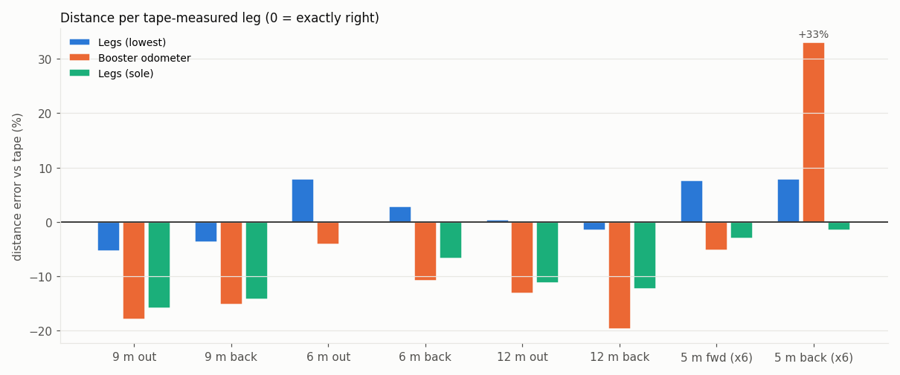

## Measurement and estimation

Our estimator uses joint angles for forward kinematics and IMU orientation to infer body motion relative to a planted foot. On a support change, the anchor transfers to the other foot. It does not estimate distance by integrating IMU acceleration or multiplying a step count by a fixed step length.

- **Sole:** fixes a point under the ankle as the contact point.
- **Lowest:** chooses the lowest of heel, sole centre and toe to approximate foot rollover; this is the current live default. Both variants are retained in the comparisons.
- **Booster:** records `/odometer_state` directly. Its reported heading is separate from the IMU heading used by our leg estimator, although the recorded headings are often close.

The robot recorder only listens. Joints and IMU are recorded at approximately 500 Hz; topic rates can differ. Replay trajectories are resampled to 20 Hz. Estimated path length is evaluated on a 0.5 s grid to reduce trunk sway. A trajectory plot is an estimator comparison, not a ground-truth tracking system.

Tape lengths were reported as 9 m, 6 m, 12 m and 5 m. Long-route boundaries use Mark presses; the repeated 5 m boundaries are inferred from trajectory reversals. Timing and imperfect stops affect these distance comparisons. For the turning test, the approximate final reference is (0.32, -0.32) m: forward-right relative to the initial heading.

## Measured-distance results

| Traversal | Tape | Booster | Legs (lowest) | Legs (sole) |
| --- | --- | --- | --- | --- |
| 9 m out | 9 m | 7.39 m (-17.9%) | 8.52 m (-5.4%) | 7.57 m (-15.9%) |
| 9 m back | 9 m | 7.63 m (-15.2%) | 8.67 m (-3.7%) | 7.71 m (-14.3%) |
| 6 m out | 6 m | 5.75 m (-4.1%) | 6.47 m (+7.9%) | 6.00 m (+0.1%) |
| 6 m back | 6 m | 5.35 m (-10.9%) | 6.17 m (+2.9%) | 5.60 m (-6.7%) |
| 12 m out | 12 m | 10.42 m (-13.2%) | 12.05 m (+0.4%) | 10.65 m (-11.3%) |
| 12 m back | 12 m | 9.63 m (-19.7%) | 11.81 m (-1.6%) | 10.52 m (-12.3%) |
| 5 m fwd (x6) | 5 m | 4.74 m (-5.2%) | 5.38 m (+7.6%) | 4.85 m (-3.0%) |
| 5 m back (x6) | 5 m | 6.65 m (+33.0%) | 5.39 m (+7.9%) | 4.92 m (-1.5%) |

## Endpoint results

All values below are discrepancies from the approximate reported endpoint, in metres. For turning, the reference includes the reported 0.46 m diagonal drift; other references are START. Differences near or below 0.3 m are unresolved by the endpoint measurements. Returning close to, rather than exactly onto, START can account for part of the observed discrepancy. For example, a 0.25 m residual could be entirely explained by a physical return within 0.3 m of START. Without a measured final position, the size and direction of this contribution are unknown; the report therefore retains the observed residuals.

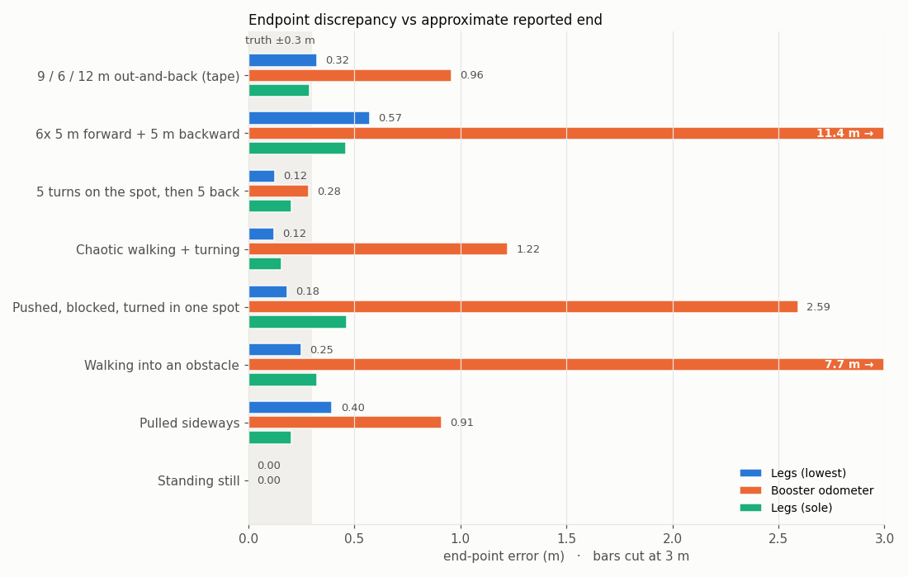

## Test descriptions and evidence

Each screenshot was captured from the local app with the playback at the end. The analytical figure underneath adds a clearer map, distance-from-start trace and leg IMU heading. The video's placeholder belongs to that specific test.

### 1. ★ 9 / 6 / 12 m out-and-back (tape)

Recording: [`lobby_1025_151300`](runs/lobby_1025_151300) · duration: **110.1 s**.

**Procedure:** The operator walked the K1 out and back along measured 9 m, 6 m and 12 m lines, turning between routes, then returned approximately to START. This is the starred main run; the intended route totals 54 m.

**Result:** Lowest is closest on these measured legs. Booster and sole generally underestimate displacement. Its largest single-leg distance error is +7.9% on the 6 m outward traversal.

| Estimate | Endpoint discrepancy | Max distance from START | Estimated path | Final relative heading |
| --- | --- | --- | --- | --- |
| Booster | 0.96 m | 10.80 m | 48.53 m | +10.6° |
| Legs (lowest) | 0.32 m | 12.11 m | 55.26 m | +10.7° |
| Legs (sole) | 0.29 m | 10.77 m | 49.63 m | +10.7° |

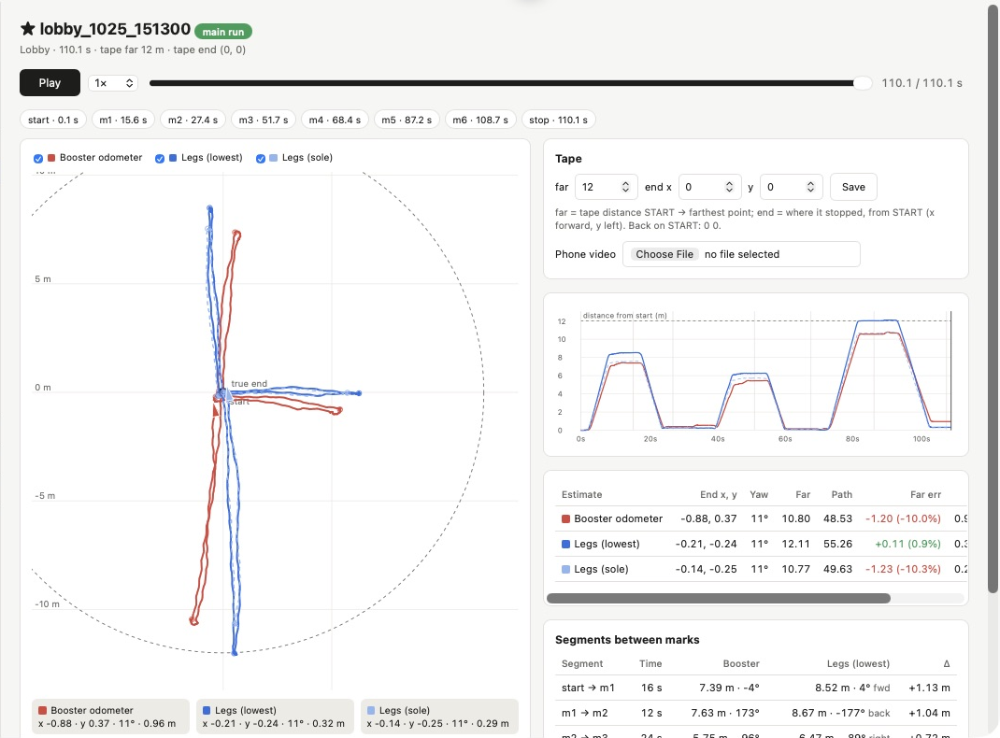

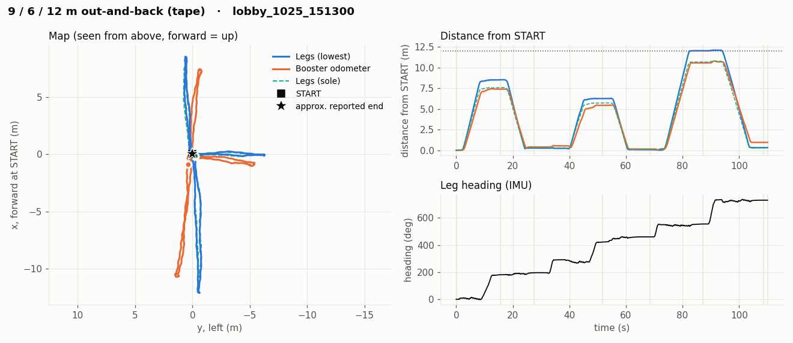

**Video:** _to attach — lobby_1025_151300_

### 2. 6x 5 m forward + 5 m backward

Recording: [`5m_front_back`](runs/5m_front_back) · duration: **107.5 s**.

**Procedure:** The operator repeatedly walked 5 m forward and 5 m backward without turning around, finishing approximately at START facing the original direction. Twelve traversals (six forward and six backward) are inferred from trajectory reversals; the repetition count was not independently counted by the operator.

**Result:** Booster overestimates the backward traversals by about 33%, producing a large residual displacement. Sole is closest on the 5 m traversals; lowest overestimates them by about 8%.

| Estimate | Endpoint discrepancy | Max distance from START | Estimated path | Final relative heading |
| --- | --- | --- | --- | --- |
| Booster | 11.42 m | 11.48 m | 69.16 m | +6.0° |
| Legs (lowest) | 0.57 m | 5.47 m | 65.40 m | +6.2° |
| Legs (sole) | 0.46 m | 4.70 m | 59.27 m | +6.2° |

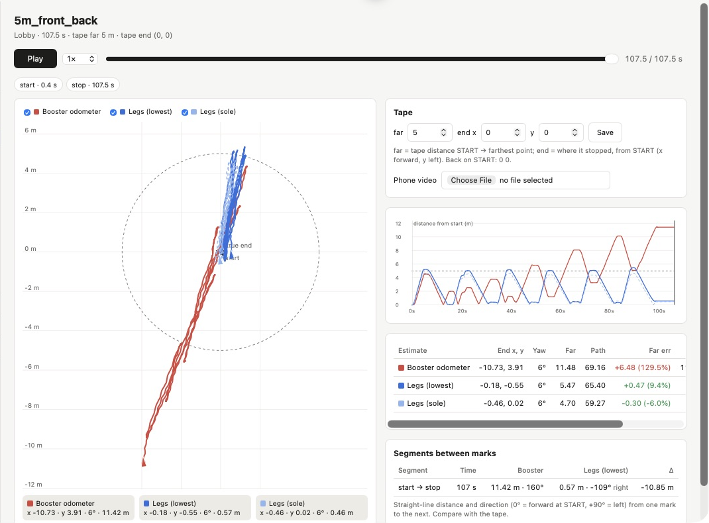

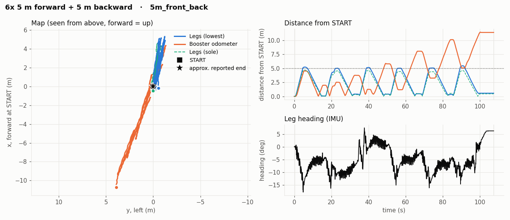

**Video:** _to attach — 5m_front_back_

### 3. 5 turns on the spot, then 5 back

Recording: [`turn_5_left_5_right`](runs/turn_5_left_5_right) · duration: **57.0 s**.

**Procedure:** The operator made five full turns one way and five the other, with little intended translation. The robot actually moved roughly 1.5 ft (0.46 m) diagonally forward-right. The operator added a small final steering correction.

**Result:** The final +17° includes the operator’s deliberate correction and should not be called heading drift. At m1, after five turns, IMU heading is about -0.4° relative to its initial direction. That is an estimated residual, conditional on the actual alignment at m1.

| Estimate | Endpoint discrepancy | Max distance from START | Estimated path | Final relative heading |
| --- | --- | --- | --- | --- |
| Booster | 0.28 m | 0.40 m | 10.31 m | +16.9° |
| Legs (lowest) | 0.12 m | 0.37 m | 2.17 m | +16.8° |
| Legs (sole) | 0.20 m | 0.43 m | 2.84 m | +16.8° |

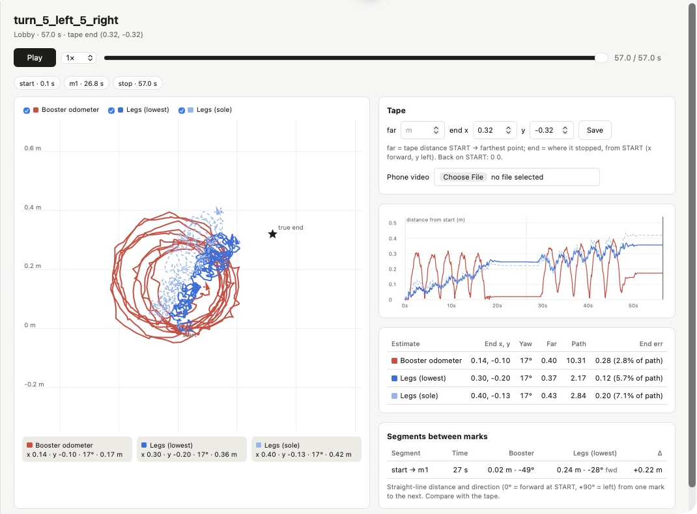

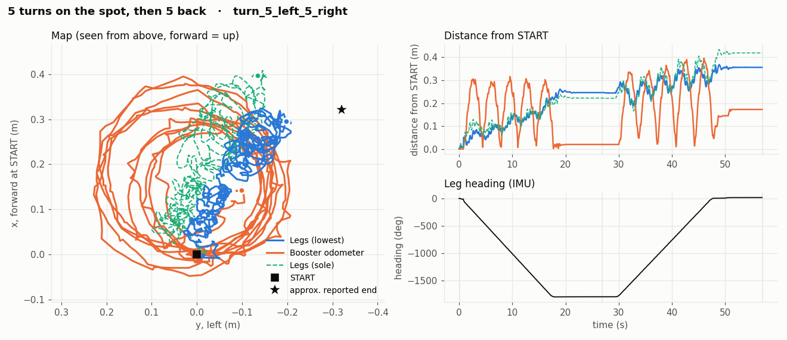

**Video:** _to attach — turn_5_left_5_right_

### 4. Chaotic walking + turning

Recording: [`mix_walk_and_turn`](runs/mix_walk_and_turn) · duration: **70.3 s**.

**Procedure:** The operator moved and turned simultaneously in a chaotic pattern many times, then returned approximately to the starting position. There was no measured ground-truth trajectory.

**Result:** Both leg variants finish close to the reported endpoint; Booster retains a larger offset. The displayed +14° final heading is not an independently measured orientation error.

| Estimate | Endpoint discrepancy | Max distance from START | Estimated path | Final relative heading |
| --- | --- | --- | --- | --- |
| Booster | 1.22 m | 1.87 m | 26.36 m | +14.0° |
| Legs (lowest) | 0.12 m | 1.69 m | 28.20 m | +14.0° |
| Legs (sole) | 0.16 m | 1.49 m | 26.39 m | +14.0° |

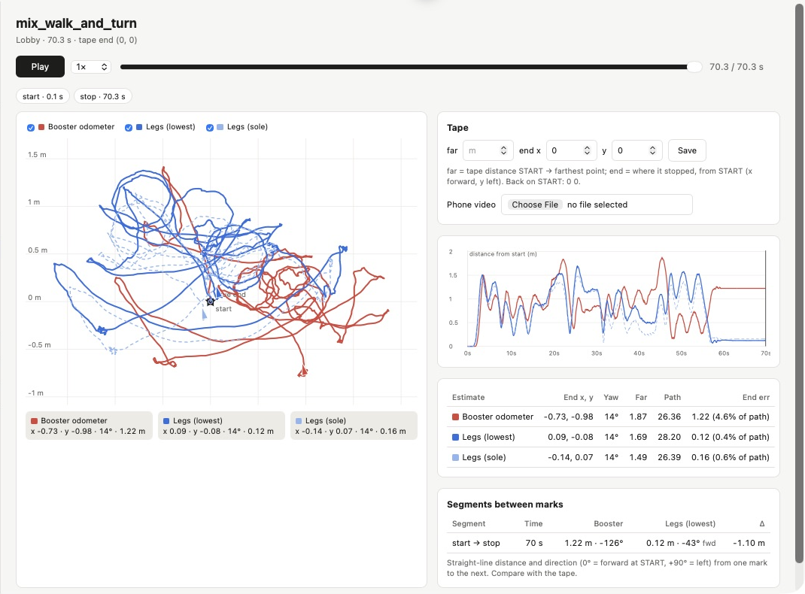

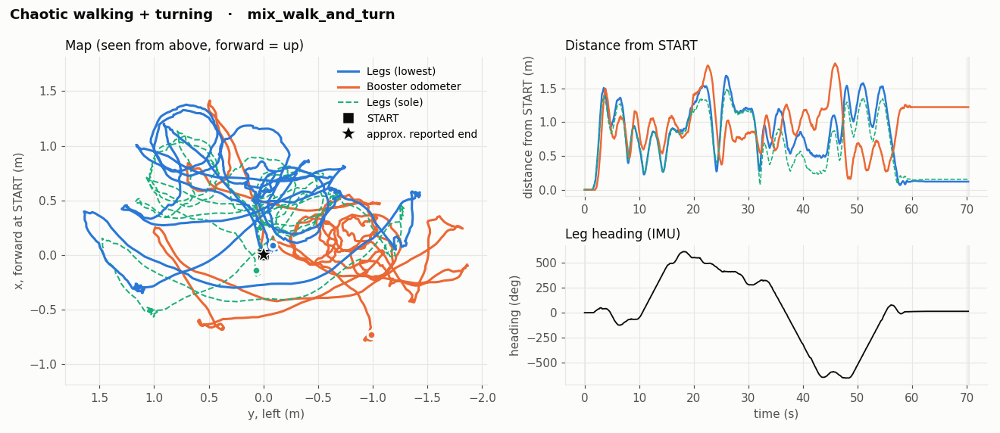

**Video:** _to attach — mix_walk_and_turn_

### 5. Pushed, blocked, turned in one spot

Recording: [`orientation_stress`](runs/orientation_stress) · duration: **81.0 s**.

**Procedure:** The operator pushed and restrained the robot, prevented its intended turns and walking, and let it step back and forth around one place. The operator finished approximately where you started.

**Result:** Booster accumulates substantially more apparent translation than the leg estimates. This is consistent with an odometer that poorly accounts for blocked motion; its internal implementation was not inspected.

| Estimate | Endpoint discrepancy | Max distance from START | Estimated path | Final relative heading |
| --- | --- | --- | --- | --- |
| Booster | 2.59 m | 3.01 m | 13.46 m | -0.9° |
| Legs (lowest) | 0.18 m | 0.94 m | 10.67 m | -0.9° |
| Legs (sole) | 0.46 m | 0.95 m | 10.69 m | -0.9° |

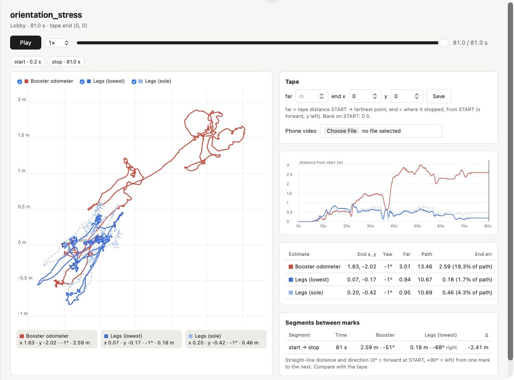

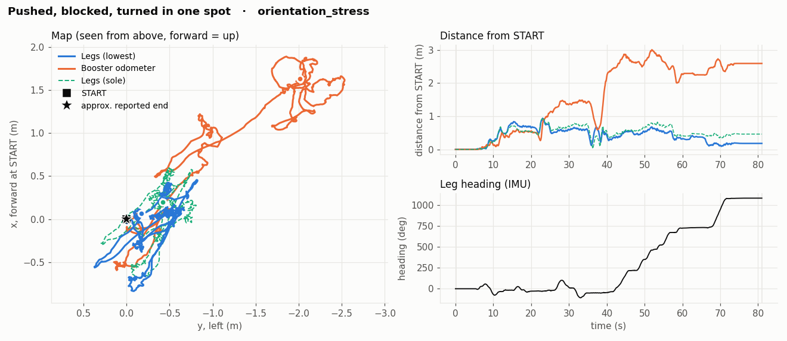

**Video:** _to attach — orientation_stress_

### 6. Walking into an obstacle

Recording: [`continuous_collision`](runs/continuous_collision) · duration: **82.7 s**.

**Procedure:** The operator repeatedly commanded walking into an obstacle, so the robot stepped under continuous obstruction, then finished approximately at the initial position.

**Result:** Booster ends nearly 7.74 m from the reported endpoint; lowest ends about 0.25 m away. Lowest still wanders up to about 1.12 m from START during the test. Endpoint closure alone does not establish accuracy throughout the collision.

| Estimate | Endpoint discrepancy | Max distance from START | Estimated path | Final relative heading |
| --- | --- | --- | --- | --- |
| Booster | 7.74 m | 8.42 m | 27.30 m | +52.3° |
| Legs (lowest) | 0.25 m | 1.12 m | 22.11 m | +52.3° |
| Legs (sole) | 0.32 m | 1.31 m | 21.03 m | +52.3° |

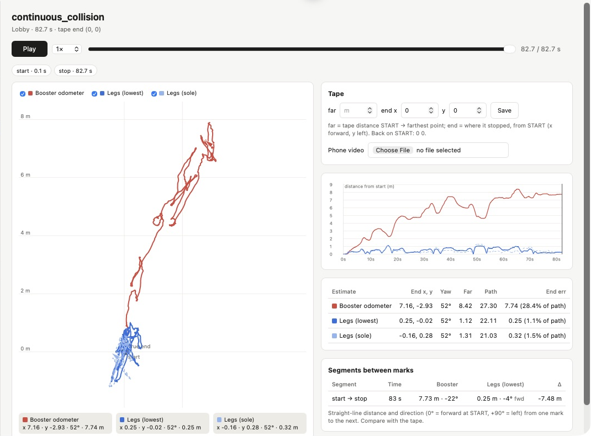

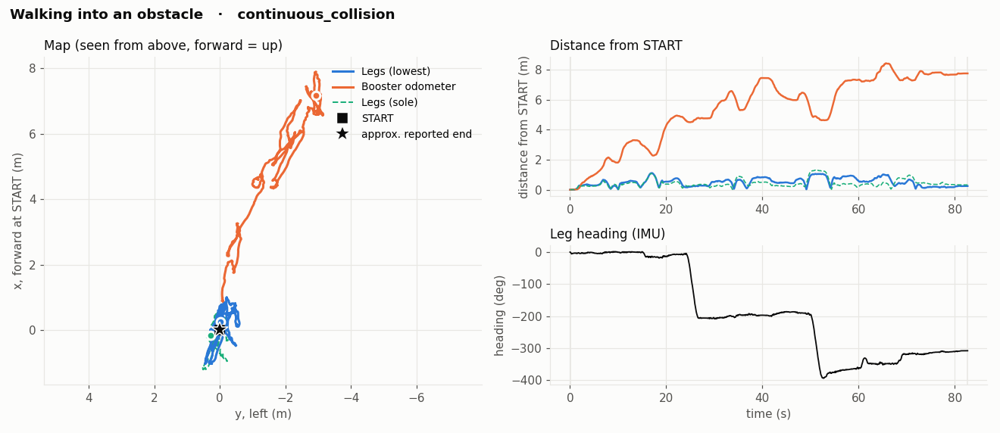

**Video:** _to attach — continuous_collision_

### 7. Pulled sideways

Recording: [`side_pull`](runs/side_pull) · duration: **47.7 s**.

**Procedure:** The operator pulled the robot sideways while it was stepping, aiming to finish at the starting point; the final position was within roughly 1 ft of START.

**Result:** Sole has the smaller endpoint residual in this test. Sliding contact is a limitation: the leg estimator assumes its support point stays fixed, so foot slip can produce unobserved motion.

| Estimate | Endpoint discrepancy | Max distance from START | Estimated path | Final relative heading |
| --- | --- | --- | --- | --- |
| Booster | 0.91 m | 1.92 m | 7.24 m | +15.3° |
| Legs (lowest) | 0.40 m | 0.61 m | 5.32 m | +15.3° |
| Legs (sole) | 0.20 m | 0.46 m | 5.03 m | +15.3° |

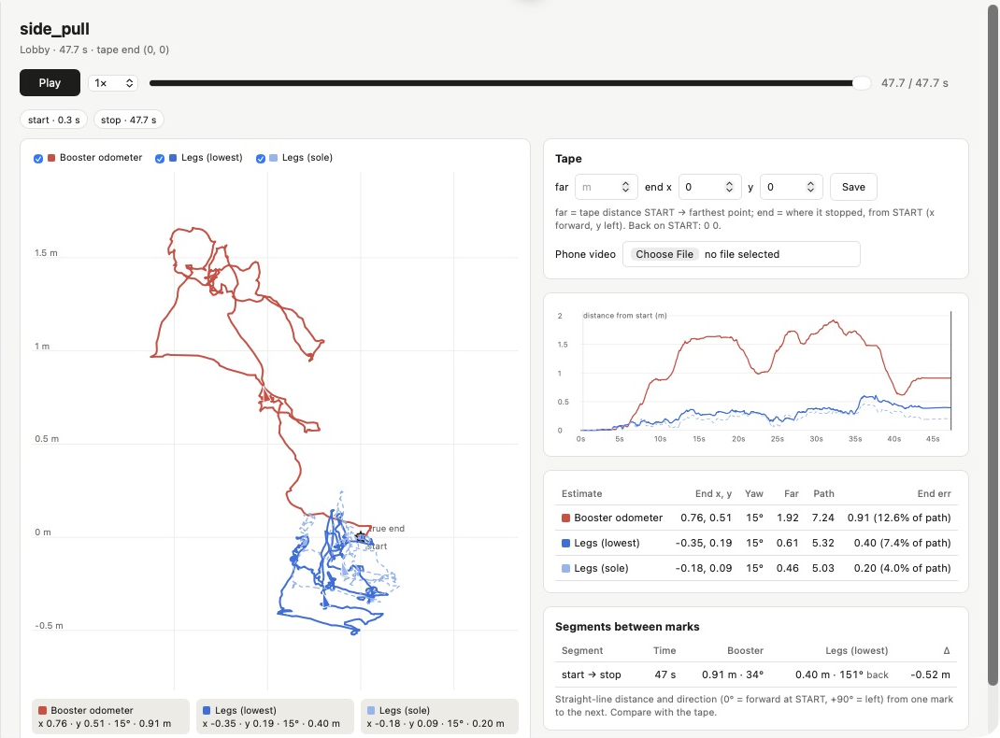

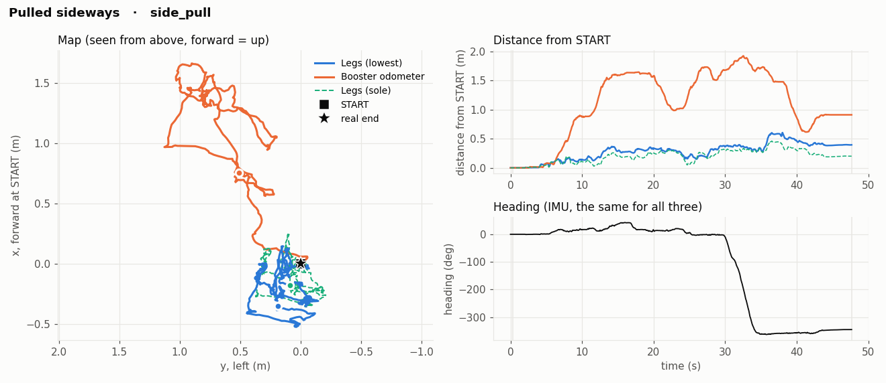

**Video:** _to attach — side_pull_

### 8. Standing still

Recording: [`standing`](runs/standing) · duration: **67.2 s**.

**Procedure:** The operator left the robot standing still and untouched for about 67 seconds.

**Result:** The replay data round the endpoint displacement to 0.000 m for all estimates; leg maximum displacement is below 1 mm in this recording. The IMU heading changes by about 0.05°. This short observation does not establish an hourly drift rate.

| Estimate | Endpoint discrepancy | Max distance from START | Estimated path | Final relative heading |
| --- | --- | --- | --- | --- |
| Booster | 0.00 m | 0.00 m | 0.00 m | +0.0° |
| Legs (lowest) | 0.00 m | 0.00 m | 0.01 m | +0.0° |
| Legs (sole) | 0.00 m | 0.00 m | 0.01 m | +0.0° |

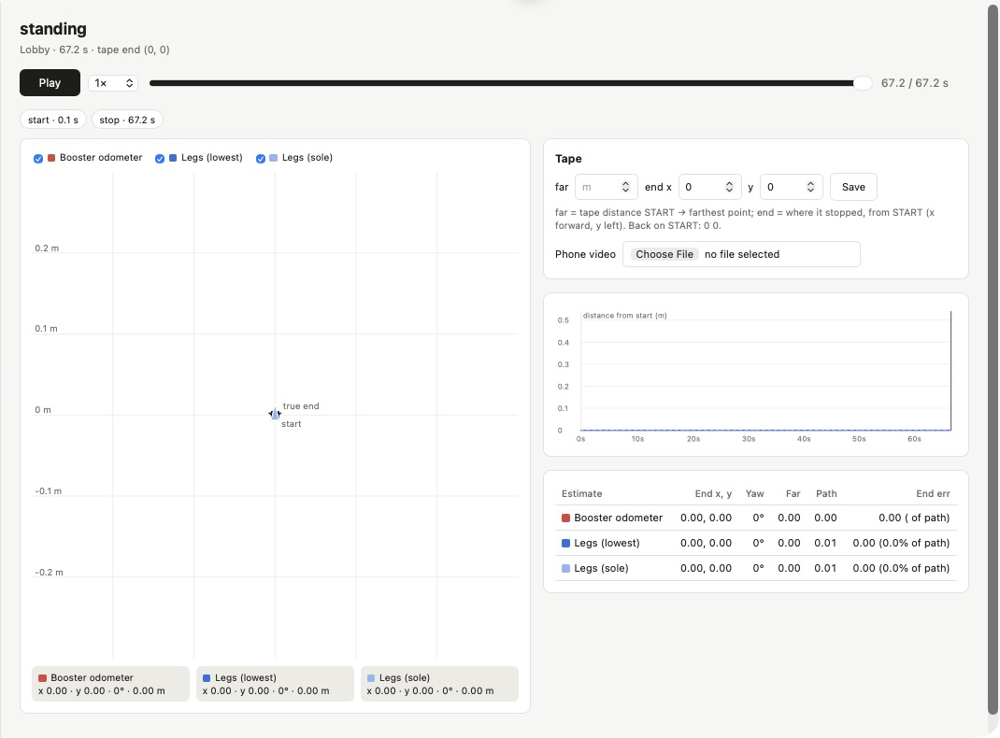

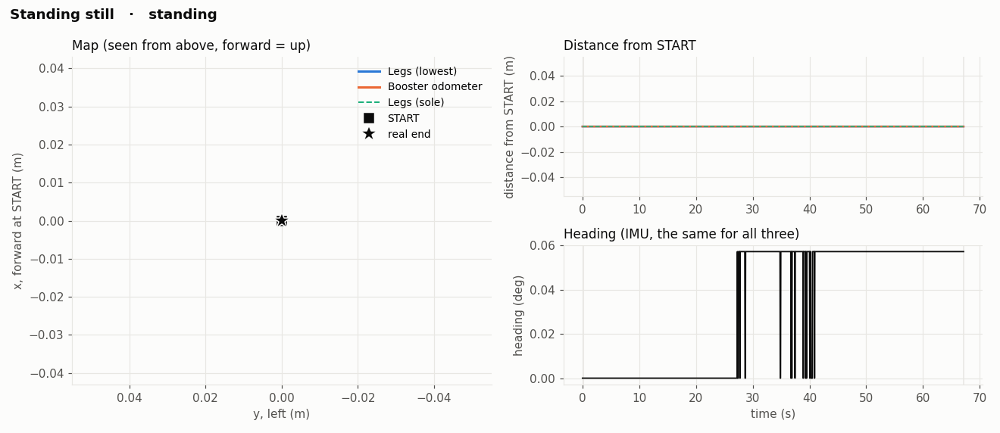

**Video:** _to attach — standing_

## Turns and orientation

Turning and walking simultaneously are included in the chaotic test, and repeated turns on the spot are included in the five-plus-five test. The leg estimates have small endpoint residuals in both, but there is no independent full-trajectory reference.

At m1 after the first five turns, the leg IMU heading is approximately -0.4° from its starting value. In the push/block test it ends around -1°. The operator reported that small differences around 5° are difficult to notice, so “facing the same way” does not establish exact alignment. These residuals cannot be assigned entirely to estimator error without an independent heading reference. The final +17° in the turn test includes the operator’s deliberate extra correction. Other final headings should be treated as recorded orientations, not measured errors. During standing, the observed change is about 0.05° over 67 s. A residual of roughly 5° can be consistent with visually similar start/end headings. This observation does not justify automatically deducting 5° from every reading.

## Collisions, pushes and slipping

During repeated obstruction, Booster's final discrepancy is 7.74 m, versus 0.25 m for lowest and 0.32 m for sole. Under pushing/blocking the corresponding values are 2.59 m, 0.18 m and 0.46 m. These trials show substantially less accumulated endpoint discrepancy for the leg estimates under the tested conditions. They do not prove Booster's internal algorithm or establish a general collision error rate.

Leg odometry depends on a stationary support contact. Sliding and rotating feet violate that assumption. A low final residual can also hide intermediate error: during continuous collision, lowest reaches about 1.12 m from START. Without a measured trajectory, we cannot separate true transient motion from estimator error.

## Limits and remaining tests

- One robot and one lobby floor; these exploratory tests do not establish repeatability across floors, speeds or robots.
- Most endpoints are approximate (about ±0.3 m); phone videos have not yet been attached or checked against the traces. There is no independent continuous position or heading reference.
- The 5 m repetition count and turning points are inferred from a leg-estimator trajectory, so this segmentation is not independent ground truth.
- Keep both contact variants until repeatable tape-measured trials resolve when each is better.
- Next measurements: three precisely marked forward, backward and sideways trials per speed; an independently measured square route; measured start/end foot positions; synchronized video for every run.

## App, replay and videos

Launch without a robot:

```bash
cd ~/k1-legodom
./k1odom site
```

Open [the local app](http://localhost:8790/#run=Lobby__lobby_1025_151300&t=end). Select a run to replay its map and statistics. To collect a new run, launch `./k1odom <robot-ip>`, then use **Start / Mark / Stop & save** on Live.

For each phone video, open the matching run, upload it, pause at a recorded Mark and use **This frame = mark** to synchronize. Uploading a video to the local app saves it locally; it does not put it in GitHub. Add the corresponding GitHub video link in the placeholder under that test when ready.

Rebuild the figures, tables and machine-readable results:

```bash
python3 make_site.py
python3 tools/build_report.py
```

Sources: the saved CSV recordings under `runs/`, each run's `truth.json` operator notes, and the local replay JSON generated by `make_site.py`. [Machine-readable metrics](report/metrics.json) record the values and distance-summary definition used here. App screenshots are stored in `report/img/app_*.png`.
