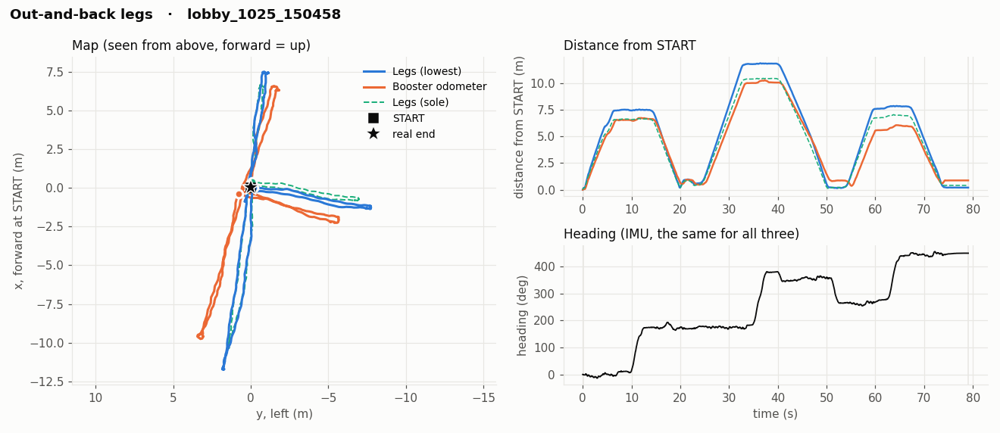
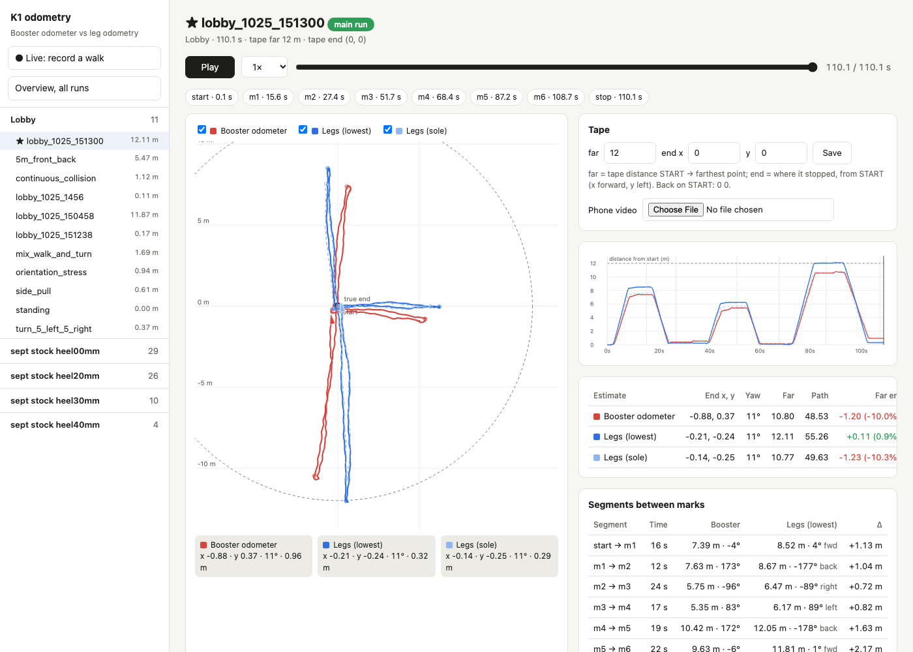

# Legged odometry on the Booster K1: lobby tests

ATR Lab · tests on 2026-10-25 and 2026-10-26, in the lobby outside the lab · code and data: this repo

**Task:** try legged odometry on the K1 and test it in the lobby.

## Summary

We ran two position estimates side by side on the real K1 while it walked in Booster's stock walking mode on the
remote, and compared both against the floor:

- **Booster odometer**: the robot's built-in odometer (`/odometer_state`).
- **Leg odometry (ours)**: the joint angles give the length of each step, the IMU gives the direction.

| | Booster odometer | Leg odometry (lowest) | Leg odometry (sole) |
|---|---|---|---|
| Distance per tape-measured leg, mean abs error (8 legs) | 14.9 % | **4.7 %** | 8.1 % |
| Walking backward, 5 m legs | **+33 %** | +8 % | -2 % |
| Worst end-point error, 9 runs that came back to START | **11.4 m** | 0.57 m | 0.46 m |
| End-point error when blocked by an obstacle | 7.7 m | 0.25 m | 0.32 m |
| Drift standing still for 67 s | 0 | < 1 mm | < 1 mm |

- **Leg odometry tracks where the feet really are.** Its end-point error stays within about 0.3-0.6 m on every run,
  including pushes, pulls, collisions and chaotic turning.
- **Booster's odometer counts the steps the robot tries to take.** When the robot is held, pushed or walks into an
  obstacle it keeps "walking": up to 7.7 m off. Walking backward it over-counts every leg by a third.
- **Heading (IMU, shared by both)** is very good: -0.4° after 5 full turns, -1° after 2300° of turning,
  0.05° drift in a minute standing still.
- The two leg variants bracket the truth: `lowest` was better on the long 9/6/12 m legs, `sole` on the 5 m legs.
  Overall `lowest` is the closer one and is the default.


## How it works

**Booster odometer.** Read from the robot as it is.

**Leg odometry.** While a foot is on the floor it does not move. The joint angles give where the body is relative
to that foot (forward kinematics of the K1 leg), the IMU gives which way the body faces, so the body's position
follows. When the other foot takes over, the reference moves to it, and the steps add up to the path. Two
variants of "the point of the foot that stays put":

- **sole**: one fixed point under the ankle (assumes the foot lands flat).
- **lowest**: the lowest of heel, sole centre and toe, so heel strike and toe-off pivot correctly.

**Recording.** A listen-only recorder on the robot (`odom_walk.py`) logs joints, IMU and both odometries at
~500 Hz; it sends no commands. A local site (`./k1odom <robot ip>`) starts and stops it and draws both estimates on
a live map while walking.

**Ground truth.** Tape on the floor: START, plus measured marks for the distance tests (9 m, 6 m, 12 m and 5 m).
For the other tests the robot was walked back to START and the real end point eyeballed (within ~1 ft / 0.3 m;
~1.5 ft forward-right for the turning test).

## Results

### Distance against the tape

Each out-and-back leg measured between the Mark presses (9/6/12 m run) or between turning points (5 m run),
straight line, against the tape.


| Leg | Tape | Booster | Legs (lowest) | Legs (sole) |
|---|---|---|---|---|
| 9 m out | 9 m | 7.39 m (-18 %) | 8.52 m (-5 %) | 7.57 m (-16 %) |
| 9 m back | 9 m | 7.63 m (-15 %) | 8.67 m (-4 %) | 7.71 m (-14 %) |
| 6 m out | 6 m | 5.75 m (-4 %) | 6.47 m (+8 %) | 6.00 m (0 %) |
| 6 m back | 6 m | 5.35 m (-11 %) | 6.17 m (+3 %) | 5.60 m (-7 %) |
| 12 m out | 12 m | 10.42 m (-13 %) | 12.05 m (0 %) | 10.65 m (-11 %) |
| 12 m back | 12 m | 9.63 m (-20 %) | 11.81 m (-2 %) | 10.52 m (-12 %) |
| 5 m forward (mean of 6) | 5 m | 4.74 m (-5 %) | 5.38 m (+8 %) | 4.85 m (-3 %) |
| 5 m backward (mean of 6) | 5 m | 6.65 m (+33 %) | 5.39 m (+8 %) | 4.92 m (-2 %) |
| **Mean abs error** | | **14.9 %** | **4.7 %** | **8.1 %** |

### End point (back to START)

| Test | Time | Booster | Legs (lowest) | Legs (sole) |
|---|---|---|---|---|
| 9 / 6 / 12 m out-and-back (tape) | 110 s | 0.96 m | 0.32 m | 0.29 m |
| Out-and-back legs | 79 s | 0.88 m | 0.20 m | 0.41 m |
| 6x 5 m forward + 5 m backward | 108 s | 11.4 m | 0.57 m | 0.46 m |
| 5 turns on the spot, then 5 back | 57 s | 0.28 m | 0.12 m | 0.20 m |
| Chaotic walking + turning | 70 s | 1.22 m | 0.12 m | 0.16 m |
| Pushed, blocked, turned in one spot | 81 s | 2.59 m | 0.18 m | 0.46 m |
| Walking into an obstacle | 83 s | 7.74 m | 0.25 m | 0.32 m |
| Pulled sideways | 48 s | 0.91 m | 0.40 m | 0.20 m |
| Standing still | 67 s | 0.00 m | 0.00 m | 0.00 m |

The real end point is only known to ~0.3 m, so leg errors below that are within the measurement.

### Heading

Both estimates use the same IMU heading, so they are identical here.

| Test | Turning | Heading error |
|---|---|---|
| 5 turns on the spot (at mark m1) | 1800° | -0.4° |
| Pushed, blocked, turned | 2300° | -1° |
| Standing still | 0° | 0.05° in 67 s (~3°/hour) |

The +17° at the end of the turning test was a manual correction by the operator, not an IMU error. For the chaotic
run (+14° after 3500°) and the 5 m run (+6°) the real final heading was not measured.

## The tests

Video slots: drag the phone videos into the GitHub editor under each test.

### 1. 9 / 6 / 12 m out-and-back (tape) · `lobby_1025_151300` (main run)
Out and back along tape-measured lines of 9 m, 6 m and 12 m from START, turning at each end. 200 steps, ~54 m.
Booster under-counts every leg by 10-20 % and its legs fan out in heading on the map; leg odometry (lowest) is
within 5 % on every leg and closes back on START within 0.3 m.


Video: _to attach_

### 2. Out-and-back legs · `lobby_1025_150458`
Three out-and-back legs in different directions, back on START. End error: legs 0.20 m, Booster 0.88 m.



Video: _to attach_

### 3. 6x 5 m forward + 5 m backward · `5m_front_back`
5 m forward and 5 m back walking backward (facing the same way the whole time), six times. Booster counts
forward legs about right but backward legs 33 % too long, so it ends 11.4 m behind START. Leg odometry counts both
directions the same and ends within ~0.5 m.


Video: _to attach_

### 4. 5 turns on the spot, then 5 back · `turn_5_left_5_right`
Five full turns one way, five the other way, without walking. Heading after the first five turns: -0.4°. The robot
really drifted ~1.5 ft forward-right while turning; all three estimates got the direction right, Booster
under-counted it (0.28 m off), legs (lowest) 0.12 m off.


Video: _to attach_

### 5. Chaotic walking + turning · `mix_walk_and_turn`
Walking and turning at the same time, randomly, ~3500° of turning, back on START. Legs end within 0.12-0.16 m,
Booster 1.22 m.


Video: _to attach_

### 6. Pushed, blocked, turned in one spot · `orientation_stress`
Pushing the robot and not letting it turn or walk, so it stepped around one spot. Booster "walked" away ~1.1 m in
5 s while the robot was held and ended 2.6 m off; legs 0.18 m.


Video: _to attach_

### 7. Walking into an obstacle · `continuous_collision`
The robot kept walking into an obstacle for 83 s. Booster counts the blocked steps as progress and ends 7.7 m off;
leg odometry sees the feet stay in place (0.25 m; it wanders up to ~1 m while the feet slip against the obstacle).


Video: _to attach_

### 8. Pulled sideways · `side_pull`
The robot was pulled sideways while stepping. Legs 0.20-0.40 m, Booster 0.91 m. Leg odometry cannot see a foot
that slides on the floor, so a hard drag is the case where it would under-count.


Video: _to attach_

### 9. Standing still · `standing`
67 s standing, not touched. Leg odometry moves less than 1 mm, heading 0.05°. Booster stays at exactly 0 (it only
counts while walking).


Video: _to attach_

## The tool

The local site (`./k1odom <robot ip>`) records from the robot with Start / Mark / Stop, draws both estimates on a
live map, and replays every run with the tape numbers, the errors and the phone video.



## Limitations

- Ground truth for the end points is eyeballed (~0.3 m). Only the 9/6/12 m and 5 m legs are tape-accurate, and those
  are measured between Mark presses / turning points, so each leg carries some timing error too.
- The robot walked in Booster's stock walking mode only. Booster's odometer reads ~0 under custom policies, so it
  cannot be used with our own controllers at all; leg odometry works with any controller.
- Leg odometry assumes the stance foot does not slide. Sliding (a hard sideways drag, a slippery floor) is counted
  wrong.
- One floor (lobby tiles), one robot, one day.

## Next steps

- One tape-precise test to settle `sole` vs `lowest`: 5 m forward, stop exactly on the mark, 3 times, plus the start
  and end foot positions taped and measured.
- Sideways walking, slow vs fast walking, a 2x2 m square with turns on the move, other floors.
- Fuse the IMU accelerometer with the legs (an EKF) to catch sliding feet.

## Reproduce

```
cd ~/k1-legodom
./k1odom 192.168.2.152        # record (robot on Kim-Elecom-5G); the site opens on Live
./k1odom site                 # browse the runs without the robot
python3 tools/report_figs.py  # regenerate the figures in report/img
```
